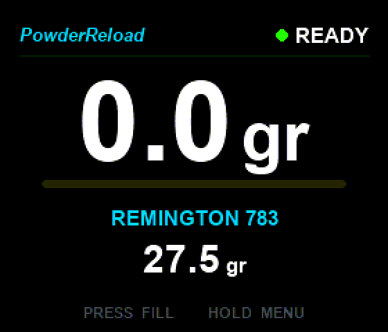
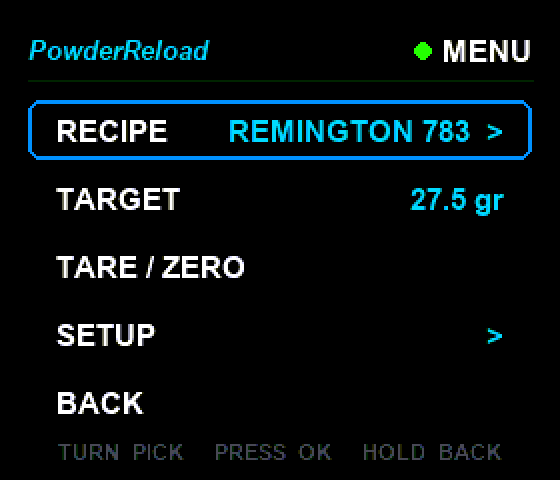
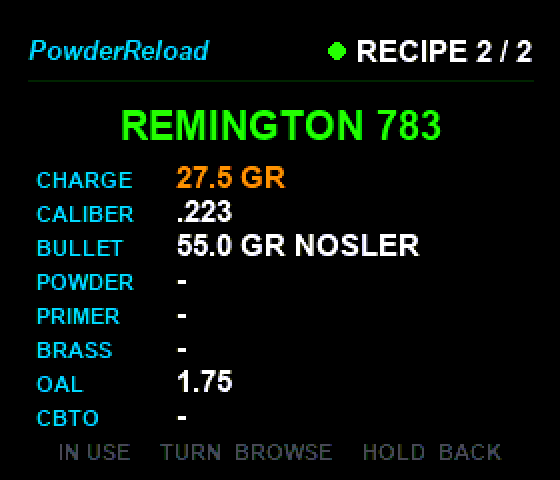
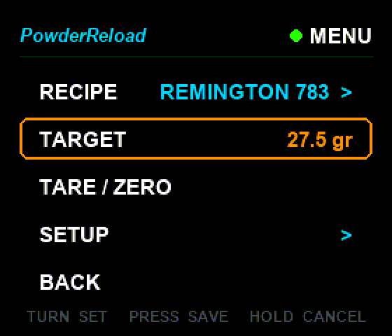
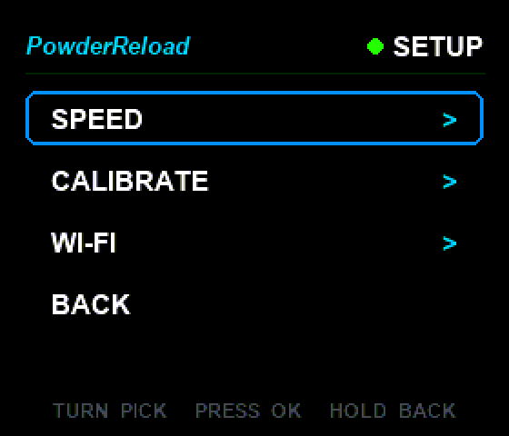
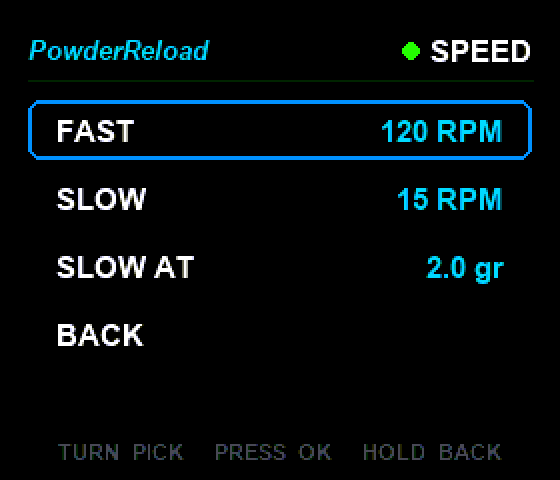
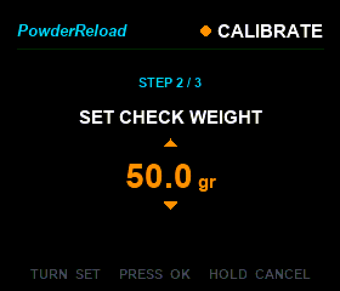
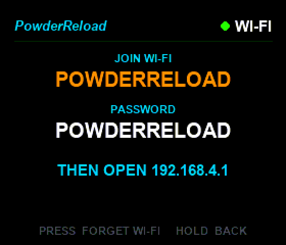

# PowderReload

ESP32 powder dispenser: LCD + one rotary encoder on the device, recipes and a fill log in a web page.
The scale is simulated (weight follows the motor) until the load cell is added.

| | | | |
|---|---|---|---|
|  |  |  |  |
| Main | Menu | Recipe details | Editing a value |
|  |  |  |  |
| Setup | Speed | Calibrate | Wi-Fi setup |

## Device

- **Main screen**: press = zero + fill, press again = stop. Hold = menu.
- **Menu**: RECIPE (browse recipes and their details, press to use one), TARGET, TARE / ZERO, SETUP, BACK.
- **Setup**: SPEED (fast RPM, slow RPM, slow-down point before the target), CALIBRATE (3 steps with a check weight), WI-FI.
- Turn to pick, press to use, hold to go back.
- **Encoder LED**: dim green ready, blue filling fast, cyan filling slow, green on target, red over target or fault, amber stopped / editing, dim white in menus.

## Web page

- First time: join the Wi-Fi **PowderReload** (password `powderreload`). The setup page opens by itself (or browse to `192.168.4.1`). Under **Wi-Fi**, pick your network and save.
- After that: **http://powderreload.local** (or the IP shown in SETUP > WI-FI).
- **Live**: weight, fill / stop / tare, recipe picker.
- **Recipes**: name, caliber, bullet and weight, powder, charge, primer, brass, OAL, CBTO, notes, speeds, last-updated date.
- **Log**: every fill with date, target, actual; average, SD, spread per recipe; CSV download.
- No password on the web page: anyone on your Wi-Fi can use it.

## Build and flash

- `flash.cmd`, or VS Code **Run Task > Flash PowderReload (COM7)**, or `pio run -e powderreload -t upload`.
- Fonts and header art: `python scripts/generate_console_art.py` (writes `include/console_art.h`).
- Screenshots from the real device: `python scripts/screenshot.py out.png [keys]`.
- Serial (115200) test keys: `+` `-` turn, `s` press, `b` hold, `?` state, `d` screen dump.
- Recipes and the log live in flash (LittleFS, 190 KB); the log keeps about the last 1500 fills.

The plain stepper bench below is still available as `pio run -e stepper_bench`.

## Stepper bench test

PlatformIO firmware for the ControlCore ESP32-WROOM-32 DevKit and single Adafruit #5880 seesaw encoder. Turn the encoder to select 1 to 225 RPM in 1 RPM increments, starting at 8 RPM. At 1 RPM one turn takes about one minute. Press the center button to command one revolution. Changes during a run apply to the next run. Presses during a run are discarded, including presses held past the stop. The encoder LED flashes blue when you turn the knob while idle, glows red during a run, and briefly brightens red if you turn the knob during a run. The LCD shows the next target RPM, the current commanded drive RPM, and the angle for the current or most recent turn. The 115200 baud serial monitor reports target RPM, angle, and status when speed or status changes.

The default configuration assumes a 1.8-degree motor and 1/16 microstepping, so each run sends 3,200 STEP pulses. Set FullStepsPerTurn and Microsteps in include/bench_motor.h to match your hardware. The ESP32 counts STEP edges and converts them to an angle from 0 to 360 degrees. The readout measures commanded travel from the start of each run. It cannot detect skipped steps or establish an absolute shaft angle. Speed ramps up and down over the move, and the driver releases the motor at the end.

## ESP32 to SparkFun Big Easy Driver

Use the driver board's 3.3 V logic setting for direct connection. On the SparkFun layout documented in the [hookup guide](https://learn.sparkfun.com/tutorials/big-easy-driver-hookup-guide/all), this means closing the 3/5V solder jumper. Check the labels on your board. Keep the ESP32 on USB power and leave the driver's VCC header disconnected.

| ESP32 | Big Easy Driver |
| --- | --- |
| GPIO27 | STEP (ST) |
| GPIO16 | DIR (DR) |
| GPIO17 | ENABLE (EN), active low |
| GND | Logic GND |

Keep ENABLE high during ESP32 reset. If adding a pull-up, use the driver's verified 3.3 V logic rail and account for independent power sequencing of the two boards. Apply motor power only after the logic connections and idle ENABLE level have been checked.

## ControlCore LCD

| LCD pin | ESP32 |
| --- | --- |
| VCC | 3.3 V |
| GND | GND |
| SCL / SCK | GPIO18 |
| SDA / MOSI | GPIO23 |
| CS | GPIO15 |
| DC / A0 | GPIO2 |
| RST / RES | GPIO4 |
| BLK / LED | Existing ControlCore backlight supply (3.3 V on the documented 8-pin module) |

The default build targets the small 1.69-inch ST7789 (240 x 280) documented in ControlCore. For the 2.8-inch ILI9341, add -DBENCH_LCD_ILI9341 to build_flags in platformio.ini and use the module-rated VCC and backlight supply. The signal pinout is the same. The LCD uses SPI. The encoder remains on I2C GPIO21 and GPIO22.

## Remaining connections

| Device | Connection |
| --- | --- |
| Adafruit #5880 VIN / GND | ESP32 3V3 / GND |
| Adafruit #5880 SDA / SCL | GPIO21 / GPIO22 |
| Motor coil pair 1 | Driver A+ / A- |
| Motor coil pair 2 | Driver B+ / B- |
| Motor supply positive / negative | Driver M+ / power GND |

Use a meter to identify the two motor coil pairs with power removed. Confirm the supply voltage against your driver revision and set the driver current limit to match the motor before the first powered test. Disconnect motor power before changing motor leads.

## Flash the stepper bench

Use **Terminal > Run Task > Flash Stepper Bench (COM7)** in VS Code, or run `flash.cmd`. Keep the motor supply off during flashing or reset. Use this test with the shaft mechanically uncoupled.

The LCD shows selected RPM, drive RPM, and commanded angle. Turn the encoder to set 1 to 225 RPM. Press once to command a revolution. The Big Easy Driver releases the coils after the pulse train. At 1 RPM a turn takes about a minute.

Build with `pio run -e stepper_bench`. The serial monitor uses COM7 at 115200 baud.
